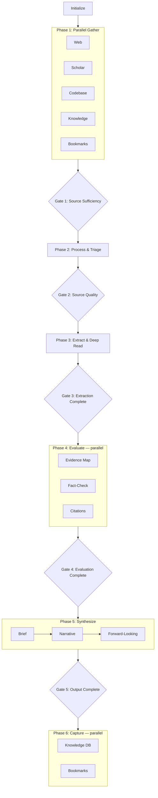

# Deep Research v3

Consolidates `deep-research` v1 (five mandatory dimensions, tier gates,
fact-check mode) and `dk.v2.deep-research` (hybrid NW+OPS architecture,
parallel gather, split sub-artifacts, plugin-based providers). One pipeline.

## When to Use

- Researching any topic comprehensively (not quick lookups)
- Literature reviews or evidence synthesis
- Technical questions with academic + web sources
- Building evidence-based arguments or due diligence
- Requests: "research", "investigate", "literature review", "deep dive"
- **Fact-check mode**: verifying claims in an existing document

## Pipeline



## Mandatory Research Dimensions

Every session MUST explore **all ten** lenses across the two framings —
a session missing a dimension fails Gate 1:

| v3 dimension | Explore |
| --- | --- |
| Field Landscape | What exists? Key terms, subfields, adjacent areas, topology |
| Key People & Publishers | Who publishes? Voices, institutions, conferences, journals |
| Alternative Approaches | Competing methods/tools, comparisons, trade-offs |
| Best Practices | Consensus, standards, established guidelines |
| Critical Essentials | Non-negotiables, foundational concepts, common pitfalls |
| Historical Context | How did the field get here? |
| Current State | What works today? |
| Key Players | Who is involved, who matters? |
| Challenges | What doesn't work, open problems? |
| Future Directions | Where is it going, open questions? |

**Gather**: 15–20 search queries covering all dimensions (field 3–4, people
2–3, alternatives 3–4, practices 2–3, essentials 2–3, cross-dimension 3–4).
Check the knowledge DB (Zettelkasten) and bookmarks (Raindrop) BEFORE the web;
target arXiv/Scholar for academic sources; flag PDFs for deep reading. Use the
active harness's web-search/fetch tools — provider-agnostic (search provider,
crawl, extract are swappable plugins, never hardcoded).

## Session Output Structure

```
session-folder/
├── state.md  log.md  manifest.md          ← IPC, phase log, inventory
├── brief.md                               ← executive summary
├── narrative.md                           ← full synthesis with citations
├── tracks/                                ← raw gather data (audit trail)
│   ├── web.md  scholar.md  codebase.md  knowledge.md  bookmarks.md
├── sources/
│   ├── register.md                        ← rated source register
│   ├── coverage.md                        ← dimension coverage
│   └── discarded.md                       ← dropped sources + reasons
├── extractions/{NNN}-{slug}.md            ← per-source deep reads
├── evidence/
│   ├── claims-map.md  craap-scores.md  fact-check.md  contradictions.md
├── forward/                               ← hypotheses, open questions, further research
├── references/citations.bib  reading-list.md
└── diagrams/                              ← optional (draw.io on request)
```

## Quality Gates

| Gate | After | Key criteria |
| ---- | ----- | ------------ |
| 1 | Gather | ≥15 sources, ≥3 categories, ALL ten dimensions covered |
| 2 | Process | Register complete, ≥3 T1–2 sources, no duplicates |
| 3 | Extract | All T1–3 sources have extraction notes, PDFs analyzed |
| 4 | Evaluate | Claims map + citations + fact-check + contradictions complete |
| 5 | Synthesize | All required artifacts present, narrative fully cited |

**Gate failure recovery**: do not silently downgrade a gate. Record the
shortfall in `state.md`, either widen the gather (rerun the failed phase with
new queries) or explicitly renegotiate scope with Daniel — never synthesize
from insufficient evidence.

## Evidence Evaluation

- CRAAP scoring per source (Currency, Relevance, Authority, Accuracy, Purpose)
- Claims map: claim → evidence → confidence
- Contradiction analysis: opposing findings paired with resolution status
- Citation management: BibTeX + reading list via the cite agent
- Fact-check discipline: verbatim quotes only from verified captures;
  otherwise paraphrase — never fabricate a quote (see the
  claim-quote-anchoring skill)

## Mode: Fact-Check — Verify Claims in Existing Content

When the request is "verify the claims in this document" (not full research):

1. **Claim extraction**: enumerate checkable claims (factual, causal,
   statistical, attribution) — skip pure opinion.
2. **Balanced evidence gathering**: search for support AND refutation per
   claim (both-query discipline); use primary sources over commentary.
3. **Verdict assignment**: supported / partially supported / unsupported /
   unverifiable — with source citations.
4. **Balance assessment**: note one-sided sourcing, missing counter-evidence.
5. **Enrichment discovery**: better data, more recent findings, adjacent
   context the document missed.
6. **Correction propagation**: proposed edits referencing exact claim locations.

**Output**: claim-by-claim verdict table + corrections + enrichment list.
**Gate**: no claim left unverified without an explicit "unverifiable" verdict.

## Anti-Patterns

- Synthesizing before Gate 2 passes (garbage-in research)
- Monolithic evidence/synthesis files — always split sub-artifacts
- Fabricating or paraphrasing quotes as verbatim
- Single-provider searching (hardcoding one search API)
- Skipping dimension coverage because early results "seemed enough"
- draw.io diagrams generated unprompted (optional, on request)
